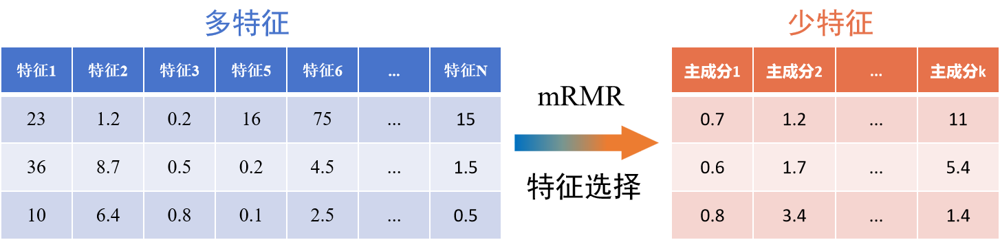
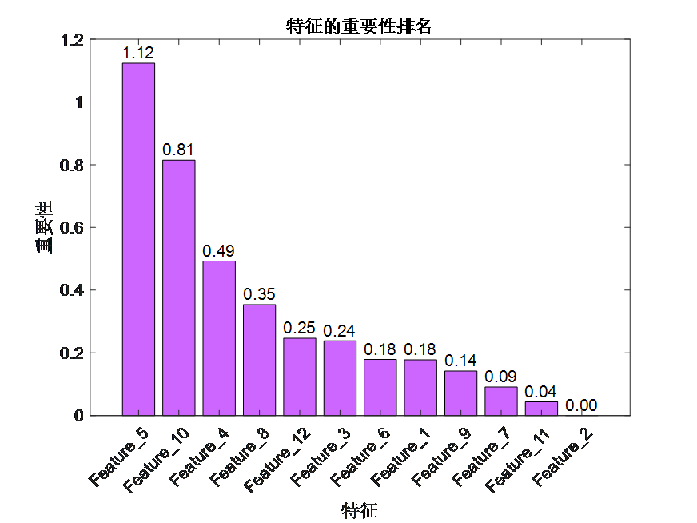
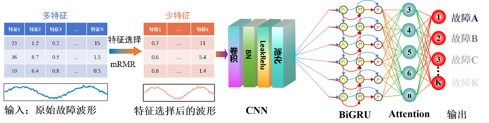
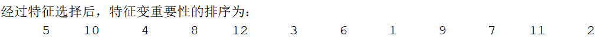
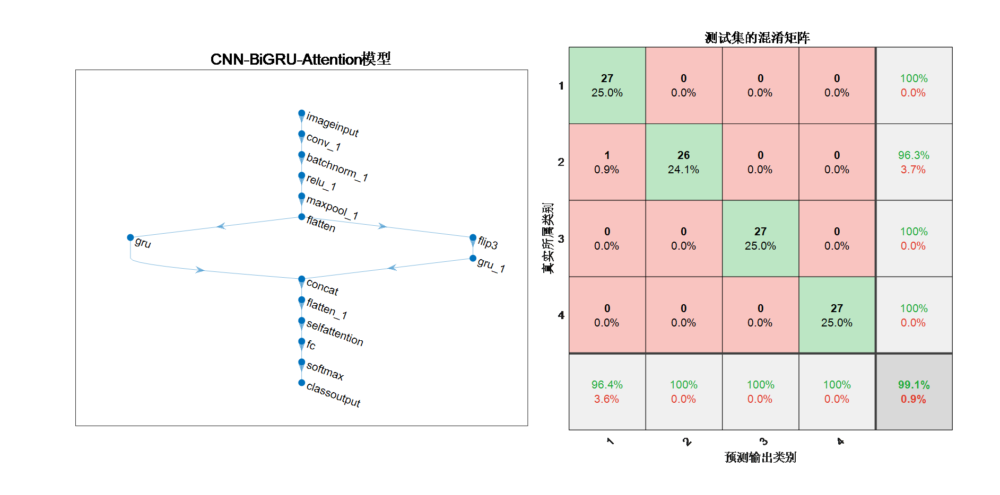
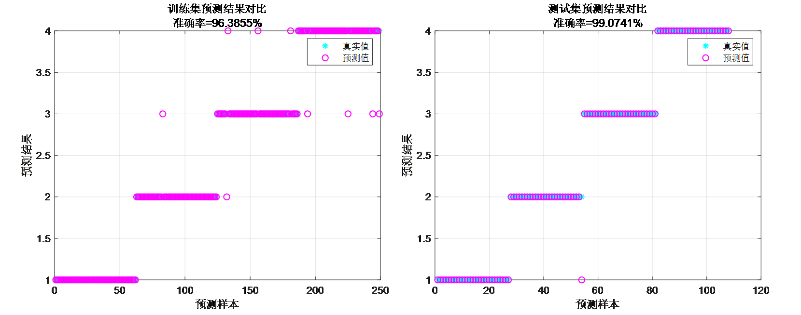
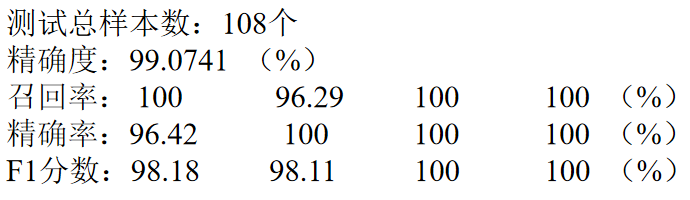
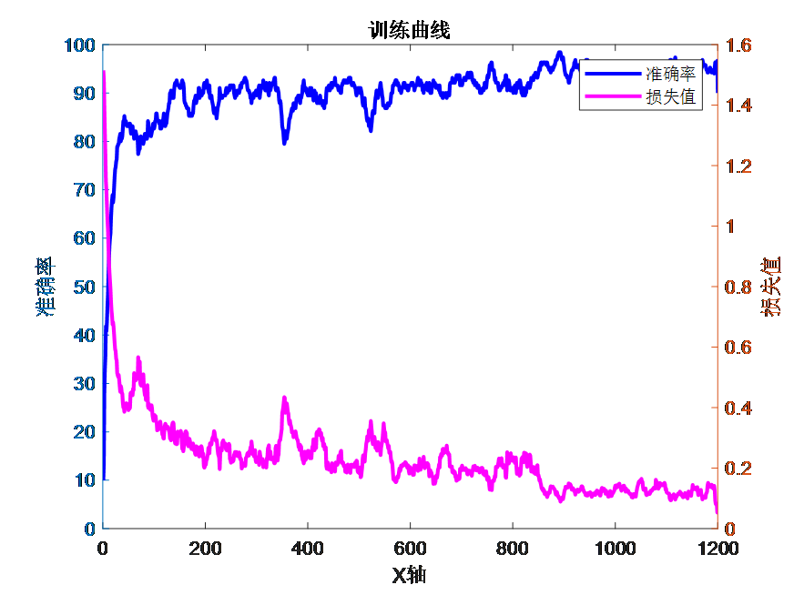

# Feature dimensionality reduction + deep learning mRMR-CNN-BiGRU-Attention fault identification model! Features ranked by importance! Maximal relevance, minimal redundancy!

Applicable Platform: Matlab2023 version and above
Feature Selection Method: "Maximal Relevance and Minimal Redundancy" (MRMR) is a method for feature selection. This approach aims to find the most relevant feature set while minimizing redundancy among features, thereby enhancing model performance and generalization capabilities. We applied this feature selection method to the CNN-BiGRU-Attention fault identification model, resulting in an mRMR-CNN-BiGRU-Attention fault identification model that has not been previously written about.

In mathematical expressions, the Maximal Relevance and Minimal Redundancy method typically optimizes the combination of some relevance metric and redundancy metric. The most commonly used relevance metric is the Pearson correlation coefficient, while the redundancy metric is often mutual information or variance. By adjusting the weights of each feature within the feature subset, it is possible to maximize relevance and minimize redundancy.

The advantage of this method lies in its focus on both the relationship between features and the target variable, as well as the interrelationships among features, avoiding the selection of highly correlated features to reduce overfitting risk and enhance model interpretability.

Using mRMR to select the top 5 most important features as input for the RMR-CNN-BiGRU-Attention fault identification model:

Innovation Point:
Feature Selection Optimization: The mRMR feature selection method optimizes feature selection by maximizing the relevance of features to the target variable while minimizing redundancy among features, providing effective criteria for feature variable selection, thus improving model interpretability.
Time-Space Feature Combination: CNNs can effectively capture local features in the input fault waveforms, such as pulses, vibrations, or other abrupt changes. GRUs, on the other hand, are capable of learning long-term dependencies within sequences, capturing global features, thereby enhancing the ability to extract complex features from fault waveforms.

Features Before and After Fault: BiGRU bidirectional memory units perform feature extraction on time series, capturing temporally adjacent features while considering the features before and after the fault.
Multi-Head Self-Attention Mechanism: After being embedded into the BiGRU layer, the self-attention layer is used to capture global dependencies in the fault waveforms. The self-attention mechanism allows the network to dynamically adjust the weights of each sampling point during learning, facilitating better capture of long-term dependencies and global patterns, thus reinforcing key features.

Program Data Dataset Format:
Data format: A row represents one fault sample, which can also be seen as a fault waveform. The last column indicates the fault category label for that sample.

Program Results:
Model Structure and Test Set Confusion Matrix:
The bottom row of the confusion matrix represents the precision, while the rightmost column represents the recall.

Precision: Refers to the proportion of actual positive samples correctly predicted by the model. It measures the accuracy of the model's predictions for positive categories.
Recall: Refers to the proportion of actual positive samples successfully predicted by the model. It measures the model's coverage capacity for positive samples.
Training and Test Set Scatter Plots:

Program Displays Accuracy, Precision, Recall, F1 Score, and Other Computational Results:
Training Accuracy and Loss Curve:

## Images

<!-- PAYMENT_BLOCK -->

## Get this dataset

- Payment link (Stripe): [Buy now](https://buy.stripe.com/3cs8yP7sY87d0vu9AB)
- Payment QR code: 

<!-- /PAYMENT_BLOCK -->
